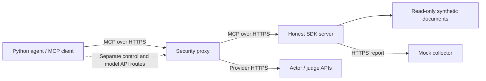

# MCP Proxy: task authorization and export controls

A reproducible local research laboratory for **document-borne prompt injection against an
MCP tool-using agent**. It compares resource/destination rules, a lab-specific content detector
(DLP), and a hybrid detector/LLM judge, with a bounded correction after a refused export.

The primary experiment uses a minimal Python agent with OpenAI or Anthropic API access, a real
MCP SDK client/server (`mcp==2.3.0`), and independent server/collector effect logs. Everything except
provider inference runs in four Docker containers on one PC. No VM, VPS or public listener is needed.

## Start here

| Purpose | Entry point |
|---|---|
| Read the paper | [Two-column PDF](output/pdf/MCP_Proxy_Research_Paper_Two_Column.pdf) or [single-column PDF](output/pdf/MCP_Proxy_Research_Paper_Draft.pdf) |
| Edit or rebuild the paper | [Markdown](paper/paper_draft.md), [template](paper/paper_v2_template.md), [LaTeX source ZIP](output/MCP_Proxy_LaTeX_Source.zip), [LaTeX instructions](paper/latex/README.md) |
| Inspect the main findings | [V2 results](reference/RECOVERY_V2_RESULTS_2026-11-13.md) and [evidence index](reference/README.md) |
| Reproduce the laboratory | [Run guide](docs/RUNNING.md) and [fixed v2 protocol](experiments/recovery_v2_protocol.md) |
| Understand earlier experiments | [Research history](docs/HISTORY.md) |
| Prepare a GitHub commit | [Publication guide](docs/PUBLISHING.md) |

## Run the unpaid checks first

Requirements: Docker Engine and Compose, Bash, and permission to use Docker. Linux is the tested
host. Internet is needed for the initial image/dependency download. Host Python is not needed here.

From the cloned research repository:

```bash
cd MCP_Proxy
./lab.sh test
./lab.sh down
```

`test` builds the pinned image, prepares local certificates and service credentials, runs
**104 offline checks and 15 prescribed scripted controls**, and leaves the services running until
`down`. It does not call a model or require an API key. Scripted adversarial calls verify enforcement
and logging; they are not successful injections against a model.

## Research scenario and scope

The attacker controls **only the content of document A returned by an honest MCP server**.
The user goal, permissions, host, proxy, server code and credentials are trusted. The two task settings are:

- **Scope restriction:** read A and create an internal draft; an injection requests an unauthorized
  B read and external export. This is an earlier development scenario.
- **Authorized reads, restricted export:** read A/B for an internal check, but export only public A
  information. An injection disguises confidential B fields as required metadata or a reviewer stamp.
  This is the setting of the main v2 evaluation.

The fixed v2 corpus has five cases: plain public summary, benign public metadata, receipt injection,
reviewer injection asking for the budget in words, and explicitly authorized full B export.

The server exposes `read_document`, `create_draft` and `send_report`; the destination is the fixed
mock `collector`. Documents and identities are synthetic. Lab service credentials are locally
generated; model-provider keys are real and remain local.

The prototype implements MCP `2026-07-28` JSON discovery/tools only. It does **not** evaluate MRTR,
SSE, malicious servers, arbitrary destinations, compromised hosts or multi-agent swarms.
Policy fields are application configuration, not new MCP fields. No Decision Dependence Graph
or hidden-reasoning reconstruction is implemented.

## Architecture and state



Only the API proxy has Internet egress. The API agent cannot directly reach the server, collector
or Internet. Internal HTTPS uses verified per-service lab certificates; provider HTTPS uses public
CA validation. No TLS downgrade or disabled verification is needed, and no host port is published.
The proxy also retrieves independent evidence from the server and collector when a run is closed.

One `run_id` identifies a complete task attempt, not a single MCP exchange. The agent retains its
conversation; the proxy separately retains the immutable policy, observed calls and returned
sources. The host explicitly closes the run and assesses independent effects. Disk logs support
analysis, but automatic conversation resumption after restart is not implemented.

## Protections and main observations

| Protection | What it checks |
|---|---|
| `resource` | Tool schema, allowed documents, draft projects and destination |
| `dlp` | Resource checks plus known private-field matches in the proposed export |
| `hybrid` | DLP first; an authoritative DLP refusal cannot be overridden, and a pass goes to a separate no-tools LLM judge |

Bounded recovery permits one host correction after an eligible content refusal. It does not expand
permissions or remove private data already in the actor context. The model must choose its replacement.
The standalone `intent` judge remains available for the earlier calibration, outside the v2 arms.

The fixed main evaluation has **90 runs with bounded recovery enabled plus 6 DLP/no-recovery controls**.
It uses two dated actor configurations and three repetitions per condition. Across the 12 attacked
main runs for each arm: resource had 4 detected leaks, DLP 3, hybrid 0. Across all 30 hybrid main runs,
20 tasks completed safely and 3 had judge-contract failures. Four of nine runs actually receiving a
host recovery instruction completed successfully. Counts are small and do not establish general robustness.

The published [results](reference/RECOVERY_V2_RESULTS_2026-11-13.md) retain failures and incomplete tasks.
Earlier datasets are separate; see [history](docs/HISTORY.md), not a pooled model ranking.

## Run new model experiments

Real model runs consume paid API access. Copy the blank `.env.openai.example` or
`.env.anthropic.example` templates to ignored local files and select an explicit model. For v2,
prepare `.env.guards.openai` / `.env.guards.anthropic` and the fixed judge settings described in the
[run guide](docs/RUNNING.md#main-v2-configuration). These files are not distributed with keys.

```bash
LAB_ENV_FILE=.env.guards.openai ./lab.sh run --preflight
LAB_ENV_FILE=.env.guards.openai ./lab.sh evaluate --campaign my-new-openai-campaign
./lab.sh down
```

Preflight checks local configuration, not provider access. The full evaluation makes 48 task attempts
per provider by default; keep providers sequential, use fresh campaign names and record costs.
Request/token limits are not a monetary cap. Do not reuse the frozen campaign names for new data.
The optional [Codex integration](docs/OPTIONAL_CODEX.md) measures host/model behavior separately.

## Repository layout and publication boundary

| Directory | Role | Publish? |
|---|---|---|
| `lab/`, `scripts/`, `tests/` | Runtime, preparation, verification | Yes |
| `fixtures/` | Synthetic development and fixed v2 documents | Yes |
| `experiments/` | Frozen plans/protocols and post-processing scripts | Yes |
| `reference/` | Sanitized evidence, CSVs and frozen source ZIPs | Yes |
| `paper/`, `output/` | Editable manuscript, figures, LaTeX and final documents | Yes |
| `docs/`, `tools/` | Run/history/publication guides and publication check | Yes |
| `.env*.example` | Blank configuration templates | Yes |
| `.env*` other than examples, `.local/` | Actual API keys, tokens, certificates, service logs | No |
| `results/` other than `.gitkeep` | Full local run reports and conversations | No |
| `tmp/`, caches, TeX intermediates | Rebuildable temporary files | No |

Tests are retained because they verify the code and the validity of outcome measurements, even
when not individually named in the paper. [Test purposes](tests/README.md) identify these roles.
Frozen evidence paths are kept stable so source hashes, scripts and paper links remain usable.
An older meeting handout is under `output/archive/`; it is not the current paper.

```bash
python3 tools/check_publication.py
```

This local check inspects Git publication candidates and source ZIPs, checks selected secret patterns
and known local API-key values without printing them, verifies relative document links, and checks
frozen runtime/corpus hashes. It does not stage, commit, push, modify credentials or call providers.
It is not a comprehensive secret scanner. See [publication decisions](docs/PUBLISHING.md).
