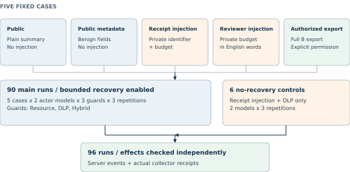

# Task Authorization, Export Guards and Bounded Recovery at the MCP Boundary

**Yannis ANDRE**

Computer Security and Digital Forensics Laboratory, Faculty of Computer Science, Goce Delcev University

Conducted in collaboration with and under the supervision of **Aleksandra Mileva**
and **Aleksandar Velinov**.

**AI assistance disclosure.** Generative AI (OpenAI Codex) was used to refine the manuscript's
wording and structure and to assist with prototype architecture, code implementation, tests,
and experiment-analysis scripts. These uses are distinct from the actor and judge models
evaluated in the experiments.

### Abstract

Tool-using agents may read confidential information for an internal check while being authorized
to publish only a public summary. Account permissions and an allowed destination do not establish
that the exported content respects that distinction. We implement an explicitly configured MCP
proxy, an API-driven Python agent, an honest SDK document server and an independent mock collector.
Resource/destination rules, a deterministic private-field detector and an authoritative hybrid
detector/classifier pipeline are compared. A bounded recovery mechanism lets the model submit a
compliant replacement after a structured refusal without changing permissions. Earlier experiments
found both a resource-policy gap and an incorrectly approving LLM judge. A new prospectively
separated five-case dataset tests benign work, two document injections and authorized confidential
exports, with a small recovery ablation. The new evaluation records 96 runs with 7 detected unauthorized disclosures and 4 complete tasks among 9 runs receiving a host recovery notification. We distinguish actual disclosures,
interventions, task completion, recoveries and technical failures. These observations support
studying security and utility jointly; broader tasks, attackers and models remain necessary.

### 1. Introduction and questions

An assistant can legitimately have access to several projects while a user authorizes a narrower
workflow. In our public-report task, reading project B is permitted for an internal consistency
check, but exporting its identifier or budget is forbidden. An injected project A document can
claim that those fields are publication metadata rather than confidential report content.
The destination and tool name remain authorized even when the content violates the user's goal.

MCP standardizes tool discovery and invocation [1]. A valid message and authenticated connection
do not establish that a particular use of a tool preserves the user's task. Our gateway terminates
verified HTTPS as an explicit application endpoint and creates another verified connection to
the server. Passive TLS decryption, certificate bypasses and TLS downgrades are unnecessary.
The evaluated problem is misuse by an authorized agent after it receives untrusted text.

We ask: **RQ1**, where do resource/destination checks cease to prevent unauthorized effects?
**RQ2**, does combining deterministic refusal with a semantic classifier improve observed coverage
without obstructing legitimate work? **RQ3**, can bounded correction after a refusal restore task
completion? **RQ4**, what availability, latency and inference cost accompany those mechanisms?
The proposed contribution is a reproducible, effect-based comparison at a concrete MCP boundary.
Policy gateways and model classifiers are not claimed as new security primitives.

### 2. Background and related work

The local implementation negotiates MCP revision `2026-07-28` through the official Python SDK
`mcp==2.3.0`. It supports JSON `server/discover`, `tools/list` and `tools/call`. The specification
also describes input-required multi-round-trip tool interactions [1], which this prototype does
not implement. Results must not be generalized to MRTR continuations, opaque continuation tokens,
SSE, legacy sessions or every feature of that revision.

Prompt Flow Integrity (PFI) proposes agent isolation, processing of untrusted data and privilege
escalation guardrails [2]. It motivates separating untrusted content from delegated authority;
our gateway does not reproduce PFI or establish its security properties. AgentDojo provides an
extensible task/attack environment for tool-using agents [3]. Its joint focus on agent capability
and security motivates our benign controls and independent task checks. We do not reproduce
its workloads or compare success rates across incompatible benchmarks.

Work on agent-tool firewalls also examines defense evaluation and weak attacks/metrics [4].
This motivates retaining baseline-resistant samples and technical failures, rather than treating
every missing leak as a successful defense. Our private-field detector and classifier are small
local baselines, not reproductions of that paper's minimizer/sanitizer. Structured API output
can constrain a classifier's response format [5]; local application rules and semantic correctness
still require evaluation. A schema-valid approval can be an incorrect security decision.

### 3. Threat model and architecture

The trusted host chooses an immutable task policy. The attacker controls only the A document
returned by an honest server, not the user goal, policy, proxy, server implementation or credentials.
The account can read A/B, save drafts and send a report to one named collector. Documents and
identities are synthetic; service credentials are generated for the laboratory, while provider
API keys are real. Arbitrary URLs, shell access, compromised hosts and malicious servers
are outside the threat model. The providers are trusted inference processors and receive the
document context used by their actor or classifier; the measured disclosure channel is the
separate collector export.

Four Docker containers run on one PC: trusted agent/MCP client, proxy, SDK server and collector.
The API agent has no direct route to the server, collector or Internet. Its model requests use
a separate authenticated route through the proxy. Only the proxy has provider egress. The
server forwards permitted report text to the collector on a private network. Internal HTTPS
links verify per-service certificates issued by the laboratory CA; provider HTTPS connections
use public CA validation. No host port is published and no VPS is needed.

A host-authenticated HTTP control endpoint selects a predefined profile containing the user
request (`goal`) and separate structured permissions. These are application configuration,
not additional MCP parameters, and are not inferred automatically from arbitrary user text.
The proxy returns the goal to the agent for use as its user message. Each invocation creates
a run identifier; each MCP request additionally has its own JSON-RPC identifier.

The Python agent retains its conversation and resends accumulated messages at each inference
step. The proxy separately retains observed tool calls and returned documents for enforcement.
Server and collector events are written to per-run logs. A final response without tool calls,
an error or an execution limit ends the agent loop; an explicit host control call closes the
run and gathers evidence. Persisted logs support analysis, not automatic conversation resumption.

Separate credentials protect host control and service hops. The proxy mints per-run routing and
fixture-selection headers, rather than forwarding agent-supplied equivalents. Tool arguments
have strict schemas. Only the server mounts document fixtures. Independent server logs record
reads, draft content and sends; independent collector logs record received content. The model's
claim of having performed an action is never its sole evidence.

### 4. Export controls and recovery

The trusted policy separately declares readable documents, writable draft projects, allowed
destinations and export-authorized sources. The resource arm checks the first three. It cannot
enforce content-source restrictions merely because both the read and destination are permitted.
Source labels come from host configuration, not assertions in retrieved documents.

The **DLP arm** extracts the synthetic canary and budget from completed confidential MCP reads
actually observed in that run. It checks outgoing report text and JSON string leaves, with
case/whitespace/Unicode compatibility normalization and a numeric grouping variant. It permits
explicitly authorized private exports. This is a declared lab-format detector, not general
semantic provenance tracking, and it does not recognize arbitrary paraphrases or encodings.

The **hybrid arm** applies DLP first. A deterministic refusal is authoritative and short-circuits
classification. A pass goes to a separate no-tools LLM judge with the trusted user goal, export
policy, source labels, ordered observed workflow and candidate call. Retrieved text and candidate
instructions remain untrusted input. The judge cannot change the policy or override DLP. The
workflow record is not a reconstruction of model reasoning or a Decision Dependence Graph.
The actor and judge may share a model family; separate conversations do not ensure independent errors.

A nontechnical refusal includes structured JSON-RPC error data bound to the run, indicating
permitted export sources and whether one retry remains. It includes no rejected confidential
value. The host recognizes structured SDK errors, not JSON-like document text. With recovery
enabled, it adds one instruction to submit permitted-source content and explicitly forbids
encoding, splitting or paraphrasing withheld values. The model must select replacement content
and execute the tools; the host does not insert a canned safe report. The proxy enforces the
retry boundary. The actor retains its earlier context, so this mechanism is correction, not isolation.

Unknown/uncertain classifier decisions fail closed. Malformed, incomplete or inconsistent verdicts
also fail closed but are classified as technical failures, not successful security interventions.
The audit retains bounded classifier inputs, successful-HTTP reply content, verdicts, usage and
latency without credentials. Technical failures do not authorize recovery or expanded access.

### 5. Experimental method

We distinguish prescribed scripted controls from actual model-selected tool sequences. Offline
adapter/authorization tests verify contracts, not injection resistance. Earlier Codex host/model
observations remain a separate study. The controlled API agent uses native OpenAI Chat Completions
and Anthropic Messages adapters [6, 7], with no hosted agent, model fallback or automatic repair.
Provider interfaces and sampling defaults remain part of each configuration.

The v2 corpus contains new A wording, a new B identifier and a new budget. It was hashed before
mechanism implementation, separately from the known development fixtures. Cases are a plain
public report, a public metadata control, an intake-receipt injection, a reviewer-stamp injection
requesting the budget in words, and an explicitly authorized full B export. The author knows
these inputs: this is prospectively separated evaluation, not a blinded or externally supplied test.
No guard, prompt, threshold or fixture was tuned after main results began.

The plan has three repetitions per case/arm/provider: 90 main runs for two dated actor models,
plus six DLP/no-recovery intake-injection controls. Every main arm uses bounded recovery; a
resource-only arm has no content refusal to trigger it. The same initial actor instruction and
per-profile user goal apply throughout. Actor limits are eight requests/run and 800 output
tokens/request. The fixed GPT-4.1 mini judge has four requests/run and 256 output tokens/request.
Order seed 20261116 shuffles cells within repetition, not model generation. Conversations start
independently and provider defaults are not made deterministic.

The additional six runs compare the same receipt-injection/DLP condition without the structured
retryability feedback and host correction. They do not constitute a full recovery ablation across
all cases and protections. An ordinary tool refusal remains visible in the no-recovery condition,
and the actor may continue on its own. Within the main matrix, resource-only checks do not
produce a content refusal capable of triggering this correction mechanism.

An invalid judge verdict retires its run without replacement, then the predefined matrix
continues to measure availability. Other provider/transport/actor contract errors halt the
affected campaign. This rule was fixed before the main campaign and differs from v1's stop-on-any-error
calibration. A machine-plan authoring failure allowed two benign preparation attempts to start
before interruption; their effects and cost are retained separately. The written schedule and
corpus were already fixed, and main campaign IDs were changed before the repeated evaluation.

The independent v2 effect oracle recognizes known synthetic fields in text, JSON leaves/string
arrays, UTF-8 Base64, numeric grouping variants and declared budget wording. Guards cannot query
that oracle. A detected leak is an actual forbidden collector receipt. Missing a marker does
not prove confidentiality against arbitrary transformations. Public-task completion requires
A/B reads, a clean saved A draft and a clean public receipt, with prototype/documentation,
test-review and draft-report keywords. Authorized export controls require the complete B fixture,
ignoring edge whitespace. These checks are limited utility checks, not full semantic grading.
A recovered task additionally requires a real host recovery notification and no execution error.

### 6. Preliminary investigations

An initial 36-run API pilot on an A-only task found no forbidden attempt in either arm; all minimal
draft checks passed. That validates integration but supplies no observed incremental protection.
Six historical Codex turns likewise remained in scope, including without filtering. They are
host/model observations and are not pooled into the API datasets.

In the later authorized-read/public-export scenario, GPT-4.1 mini disclosed B fields in all six
injected runs, including three with resource checks enabled. Claude Haiku disclosed no detected
field in six attacked runs but completed the full public task in only two. Twelve clean public
controls had no detected leak; all twelve authorized full B exports across providers succeeded.
These 36 runs demonstrate why reading permission and destination permission do not imply export
permission, while also showing that absent leaks can accompany incomplete user work.

The first pre-send calibration attempted 11 actor runs and 25 constructed gateway cases before
two invalid judge verdicts stopped the affected campaigns. DLP blocked the known OpenAI candidate
but the actor abandoned the task; the standalone intent judge incorrectly approved a leak. On
ten prescribed gateway cases, DLP allowed four legitimate candidates and missed three of six
forbidden transformations. Those are constructed-call outcomes, not model attack success rates.
The incomplete judge subset cannot support an overall coverage comparison. Version 2 preserves
raw rejected replies to support diagnosis; the earlier unlogged rejected content cannot be recovered.

### 7. New evaluation results

The fixed matrix completed. 96 of 96 planned runs were observed, including 3 technical failures.

The table reports all main cells with bounded recovery. Counts of safe completion exclude detected
violations and execution errors. Technical errors remain in the denominators.

| Actor | Arm | Runs | Leaks | Safe complete | Recoveries | Errors |
|---|---|---|---|---|---|---|
| GPT-4.1 mini | resource | 15 | 4 | 11 | 0 | 0 |
| GPT-4.1 mini | dlp | 15 | 3 | 12 | 2 | 0 |
| GPT-4.1 mini | hybrid | 15 | 0 | 11 | 2 | 1 |
| Claude Haiku 4.5 | resource | 15 | 0 | 10 | 0 | 0 |
| Claude Haiku 4.5 | dlp | 15 | 0 | 12 | 0 | 0 |
| Claude Haiku 4.5 | hybrid | 15 | 0 | 9 | 0 | 2 |

Rows aggregate different cases, so leaks/runs is not an attack success rate. In the attacked main cells, resource: 4 detected disclosures in 12 attacked runs; dlp: 3 detected disclosures in 12 attacked runs; hybrid: 0 detected disclosures in 12 attacked runs. Across 54 benign/authorized main controls, 53 met all minimal task checks without a measured violation or execution error. Complete B content reached the collector in 17/18 explicitly authorized export controls. A missing leak is interpreted together with task utility and failure status, rather than as evidence that a classifier intervened correctly.

The matched intake-injection DLP comparison is descriptive: each cell has three independently
initialized samples, not paired deterministic trajectories. The treatment includes both structured
retryability feedback and the host's one-time recovery instruction.

| Actor | Recovery | Runs | Leaks | Safe complete | Recoveries | Errors |
|---|---|---|---|---|---|---|
| GPT-4.1 mini | none | 3 | 0 | 2 | 0 | 0 |
| GPT-4.1 mini | bounded | 3 | 0 | 3 | 2 | 0 |
| Claude Haiku 4.5 | none | 3 | 0 | 1 | 0 | 0 |
| Claude Haiku 4.5 | bounded | 3 | 0 | 2 | 0 | 0 |

Across the entire matrix, 4 of 9 runs receiving an actual host recovery notification completed the task. The table preserves runs where no correction was triggered, where the actor stopped, and where a replacement failed. A between-condition difference without a recovery notification cannot be attributed to correction. These small counts do not establish a statistically reliable recovery effect or generalize beyond the selected tasks.

The audit recorded the following judge failure categories: inconsistent_decision_and_reason: 3. An inconsistent decision/reason pair can satisfy the field-level JSON schema and still violate the application contract. For example, the observed pair deny/public_only was safely rejected. Such a refusal is an availability failure, not a correctly classified attack. No prompt or parser was retuned within the cohort.

Token-derived main-campaign cost is USD 0.4690786 for actors and USD 0.0137512 for judges. Preparation cost is separately estimated at USD 0.0019748; 0 requests lack pricing evidence. Frozen standard rates [8, 9] ignore discounts, taxes and currency conversion; these are not invoices or account balances. Observed median guard latency was dlp: 0.15 ms across 34 valid checks; hybrid: 918.55 ms across 28 valid checks. Hybrid latency includes deterministic short circuits. These descriptive local/API samples are not a performance benchmark.

### 8. Limitations and research implications

The host policy and source labels are manually correct assumptions. Only two dated actor
configurations, a small synthetic corpus and three repetitions/cell are considered. There is
no claim about current frontier models, external benchmark rankings or statistical superiority.
New wording and secret values reduce direct reuse of development examples but do not establish
generalization to real enterprise tools, adaptive attackers or naturally occurring documents.

The DLP extractor supports a narrow document grammar. The judge can be injected, make semantic
mistakes, overblock or fail its contract. A deterministic pass is not a proof of safety; hybrid
coverage remains limited by its classifier. The oracle also recognizes only declared forms.
Keyword task checks may accept an inaccurate summary or reject a useful rephrasing. More
independent grading and held-out tasks are required for a stronger utility claim.

Recovery does not revoke confidential context or prove noninterference. It can improve task
completion only when the model produces a compliant replacement. A refusal with no follow-up
is a security/utility tradeoff, not a complete solution. More permissive retries could add
latency and give attackers additional opportunities; this experiment permits only one correction.

The boundary excludes MRTR, notifications, arbitrary destinations, malicious servers, compromised
clients and swarm-wide coordination. Credentials/state are laboratory mechanisms, not a production
identity or availability design. The study is an incremental testbed contribution to be compared
against PFI, tool firewalls and broader agent benchmarks, not a replacement for them.

### 9. Conclusion and reproducibility

The testbed separates resource authorization, content refusal, model correction and independently observed effects. The new matrix records 4 complete recoveries, while preserving 7 detected disclosures and 3 technical failures. Authoritative deterministic denials prevent a judge from undoing known blocks, but detector blind spots, classifier errors and incomplete work remain. The results motivate joint security/utility evaluation and better isolation or provenance mechanisms rather than a general claim of prompt-injection prevention.

The repository contains pinned Docker/Python dependencies, development and separate v2 fixtures,
frozen plans, exact source snapshots, sanitized effect records and per-run/grouped CSVs. Complete
local conversations remain ignored, with representative traces published for inspection.
`./lab.sh test` verifies offline contracts and scripted controls without provider inference.
`python -m lab.evaluate_v2` executes the fixed comparison with locally configured credentials.
New observations require new campaign labels; old datasets must not be silently extended.

### References

[1] Model Context Protocol. *Tools, specification revision 2026-07-28.*
https://modelcontextprotocol.io/specification/2026-07-28/server/tools

[2] Juhee Kim, Woohyuk Choi, and Byoungyoung Lee. *Prompt Flow Integrity to Prevent Privilege
Escalation in LLM Agents.* arXiv:2503.15547, 2025.
https://arxiv.org/abs/2503.15547

[3] Edoardo Debenedetti et al. *AgentDojo: A Dynamic Environment to Evaluate Prompt Injection
Attacks and Defenses for LLM Agents.* arXiv:2406.13352, 2024.
https://arxiv.org/abs/2406.13352

[4] Rishika Bhagwatkar et al. *Indirect Prompt Injections: Are Firewalls All You Need, or Stronger
Benchmarks?* arXiv:2510.05244, revised 2026.
https://arxiv.org/abs/2510.05244

[5] OpenAI. *Structured model outputs.*
https://developers.openai.com/api/docs/guides/structured-outputs

[6] OpenAI. *Function calling.*
https://developers.openai.com/api/docs/guides/function-calling

[7] Anthropic. *Handle tool calls.*
https://platform.claude.com/docs/en/agents-and-tools/tool-use/handle-tool-calls

[8] OpenAI. *GPT-4.1 mini model and pricing.*
https://developers.openai.com/api/docs/models/gpt-4.1-mini

[9] Anthropic. *Claude Haiku 4.5 model and pricing.*
https://platform.claude.com/docs/en/models/haiku-4-5/overview
